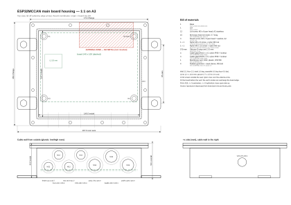

# Main board housing

A two-part housing (base and lid) for the plan4 main board, 140 × 100 mm. It is **screwed shut** and
**IP67 by design**. The first parts are **3D printed in ASA**; the same geometry is meant to be
**injection moulded** later.

- **Design:** `docs/superpowers/specs/2026-11-22-main-board-housing-design.md`
- **Build plan:** `docs/superpowers/plans/2026-11-22-main-board-housing.md`

Every dimension traces back to `hardware/mccan.kicad_pcb`. Nothing here edits the board.

## Decisions (owner, 2026-11-22)

| Topic | Decision |
|---|---|
| How it is made | ASA print for prototypes; injection moulded in production. Uniform 2.5 mm wall, 1° draft, no undercuts except the H2 nut slot (below) |
| Sealing | IP67 design. A Ø2 mm silicone cord sits in a face groove in the base rim, all 13 lid screws are **outside** the seal (pitch ≤ 54 mm all round), and there is a membrane vent |
| Mounting | Four gusseted ears with rubber grommets and steel sleeves, M5 to a bracket. The floor faces the bracket; mount with the gland wall down or sideways |
| Cable entry | Seven nylon glands in two staggered rows on the cable wall, one per sheathed cable (`harness.md` §2), with 5 mm spanner room round every hex |
| J2 | No port: take the lid off to program |
| CAD | Autodesk Fusion, driven by script |

## Antenna zone: no metal

The zone is x 55.75–134.25, from 15 mm beyond the antenna edge to y 21.44, at every height
(`enclosure.md` §2). These choices keep metal out of it:

- **The lid screw over the antenna (x 97) is nylon:** an M3 × 12 into a captive nylon nut, in a
  pocket at the bottom of its flange boss. The pocket is outside both the wall and the seal, so it is
  no leak path. That keeps the seal clamped every ≤ 54 mm along the antenna edge too.
- **H2 is fixed with a nylon M3 × 8 screw into a captive nylon nut.** The hole's centre is 15.75 mm
  from the antenna span, so a brass insert or a steel screw head would reach about 13 mm. The nut
  slides in through a slot in the boss's cavity side. Printing that is easy; moulding it needs a
  side action. The screw passes right through the nut, and its tip stops 1.1 mm above the hole floor.
- The glands and vent are nylon or plastic. **The bike bracket must stay clear of the zone too.**

## Clearance check results (2026-11-22, after review fixes)

`build_housing.py` imports the board STEP (`ref/mccan-board.step`, 163 bodies) and places it on the
standoffs. It adds envelope blocks (courtyard × height) for the 20 parts whose height does not come
from a resolved 3D model, L2 among them at its datasheet 24.0 mm. Then it runs Fusion's interference
analysis.

| Check | Result |
|---|---|
| Interference, housing / hardware / glands × board / envelopes | **0** |
| Same check with `lid_gap = −2`, to prove it can fail | 1 hit: lid × L2 |
| Lid underside to the tallest part (L2) | **10.9 mm** (≥ 3 required; the gland rows set the height) |
| Glands and vent to the nearest board body | **1.6 mm** (the vent's inside nut over the PCB) |
| Metal bodies in the antenna zone | **0** |
| Rule checks in `layout.py`: screw pitch, seal, gland tool room against the drafted wall, bosses, H2 screw length, wall gap, vent against the board, parts, ears and flange | all pass |

Interior: **146 × 125 × 44.6 mm**. Flange: 171 × 150 mm. Over the ears: **207 × 150 × 50.1 mm**,
plus the glands, which stick out about 25 mm. **The size has not yet been confirmed** against the
space under the fairing: do a trial fit. The ear and flange sizes are parameters. The 5 mm spanner
room round the glands is what sets the height; shrink `tool_gap` in `layout.py` if the glands bought
need less.

## Bill of materials

| Item | Qty | Notes |
|---|---|---|
| Base, ASA | 1 | `export/housing-base.stl` |
| Lid, ASA | 1 | `export/housing-lid.stl` |
| Lid screw, M3 × 8 pan head, A2 stainless | 12 | |
| M3 brass heat-set insert, 5.7 mm long (hole Ø4.0) | 15 | 12 lid + 3 board. **[TO CONFIRM]** part |
| Board screw, M3 × 6 pan head + washer, A2 | 3 | H1, H3, H4 |
| Nylon M3 × 8 screw + nylon M3 nut | 1 + 1 | H2 (antenna zone) |
| Nylon M3 × 12 screw + nylon M3 nut | 1 + 1 | The lid screw over the antenna |
| Silicone O-ring cord, Ø2.0 mm | ~579 mm | Cut and join into a loop (cyanoacrylate for silicone) |
| Cable gland M12 × 1.5, nylon, IP68, with locknut | 4 | feed A, front, rear, CAN. **[TO CONFIRM]** clamp range against the cable ODs; modelled at AF 15 |
| Cable gland M16 × 1.5, nylon, IP68, with locknut | 3 | pod L, feed B, pod R. **[TO CONFIRM]**; modelled at AF 19 |
| Membrane vent, M12, plastic, IP67/68 | 1 | **[TO CONFIRM]** part; modelled as Ø18 |
| Rubber grommet + steel sleeve, M5 bolt | 4 | **[TO CONFIRM]**; hole Ø9.5, panel 3 mm |

Part numbers are not invented here (`enclosure.md` rule). If the glands bought have bigger hexes than
modelled, change the AF in `layout.py`: the interior grows, by up to 15 mm, until the rows fit.

## Assembly order

1. Heat-set the 15 inserts flush. Push the nylon lid nut into its pocket under the flange.
2. Slide the H2 nylon nut into its boss slot, then fit the board: three M3 × 6 steel and one nylon
   M3 × 8.
3. **Fit the vent after the board.** Its inside nut overhangs the board edge by about 2 mm, so the
   board cannot be lowered in past a fitted vent.
4. Glands: thread the cables through, solder the tails, then tighten the glands. Leave a service loop.
5. Lay the cord in the groove, then fit the lid with its 13 screws.

## Printing (prototype)

- ASA, 0.2 mm layers, **≥ 5 perimeters** (so the 2.5 mm wall is solid), ≥ 6 top and bottom layers.
- Print the base open side up and the lid with its top face down, so both gasket faces come off smooth.
- **The base needs supports** under the 10 mm flange overhang and the insert bosses hanging below
  it. The ear gussets need none.
- Expect about IP65 as printed. Vapour-smooth the part or apply a sealing coat if a printed part has
  to reach IP67.

## Checks on the bike

1. **Trial fit:** under the fairing next to the charge board, with the gland wall down or sideways and
   the bracket clear of the antenna zone.
2. **Dunk test:** lid closed, glands done up on cable stubs, vent fitted. Submerge to 1 m for 30 min,
   then look for water.
3. **WiFi:** RSSI to the phone with the lid on, compared with the lid off, on the bike.

## Regenerating

Run from the repo root.

1. `python hardware/enclosure/extract_board.py` writes `board.json` from the board file.
2. `python hardware/enclosure/layout.py` writes `layout.json`, and exits 1 on any rule violation.
3. `sh hardware/enclosure/ref/make_ref.sh` exports the board STEP. It is git-ignored.
4. In Fusion, run `build_housing.py`. Use Scripts and Add-Ins, or the MCP with a wrapper that
   `exec`s the file and calls `build_and_check(<this folder>)`. It builds or rebuilds the
   "ESP32MCCAN Housing" document, runs the check, and on a pass writes `export/`.
5. `python hardware/enclosure/drawing.py` writes `export/housing-drawing.svg` (A3, 1:1).

Tests (plain scripts, which exit 1 on failure):

- `python hardware/enclosure/test_extract_board.py`
- `python hardware/enclosure/test_layout.py`

Edit dimensions in `layout.py` (`P`), not in Fusion. The model is direct-modelling bodies, rebuilt
from scratch on every run.

## Files

| File | What it is |
|---|---|
| `extract_board.py` | Reads the board file into `board.json`: outline, holes, part courtyards and heights (datasheet floor for L2), wire tails, the antenna zone |
| `layout.py` | Every housing coordinate and every design rule, written to `layout.json` |
| `build_housing.py` | Fusion script: draws `layout.json`, runs the interference check, exports |
| `drawing.py` | The A3 drawing |
| `export/` | `housing-base.step/.stl`, `housing-lid.step/.stl`, `housing-assembly.step` (with the board), `esp32mccan-housing.f3d`, `housing-drawing.svg` |

## Open items

- Part numbers and AFs for the glands, vent, inserts and grommets.
- Trial fit for the overall size.
- The vent sits mid-wall (z 20.1 mm), not low down. Its inside nut has to clear the board edge, which
  is only 3 mm from the side wall.
- The H2 nut slot needs a side action if moulded. The alternative is a moulded-in nylon nut.
- 16 parts' KiCad 3D models do not resolve on this PC. One of them is L2, whose model path is
  `7448031002.stp` while the file is `hardware/3dmodels/Wurth_WE-CMBNC_7448031002.stp`. This only
  affects 3D exports, and it was reported to the Main Board session. **Even resolved, L2's STEP
  reads 11.6 mm** (no standoff), so the extractor keeps the datasheet 24.0 mm as a floor.
- Deferred review minors:
  - the vent is not rule-checked against the +x insert boss (1 mm today);
  - the H2 nut slot leaves thin boss walls on its +x side;
  - the antenna check has no margin beyond the screw-head radius;
  - rotations other than multiples of 90° are not handled in `extract_board.py`.
